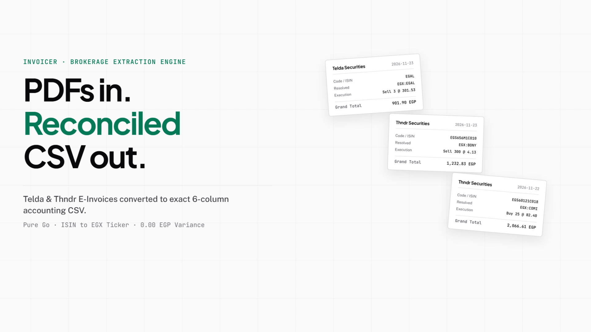

# invoicer

[](https://github.com/scptric/invoicer/releases)
[](LICENSE)

Pure-Go, zero-CGO smart PDF invoice extraction engine by **Scptric** that converts brokerage PDF E-Invoices (Telda Securities, Thndr Securities Brokerage, and generic trade confirmations) into accounting-ready CSV files matching [samples/reference/CSV Format.csv](samples/reference/CSV%20Format.csv) or structured JSON for web apps.

## Documentation

- **[How to Run (`docs/HOW_TO_RUN.md`)](docs/HOW_TO_RUN.md)** — Simple step-by-step guide, copy-paste commands, flags, custom symbols, and building from source.
- **[Project Overview & Next.js Integration (`docs/PROJECT_AND_NEXTJS_INTEGRATION.md`)](docs/PROJECT_AND_NEXTJS_INTEGRATION.md)** — How the engine works and how to plug it into a Next.js upload flow backed by a `transactions` database table.
- **[Changelog (`CHANGELOG.md`)](CHANGELOG.md)** — Release history and notes (`v0.0.7`).

## Releases

- **[Releases](https://github.com/scptric/invoicer/releases)** — Download prebuilt `invoicer` CLI archives (`v0.0.7`) for Windows (`amd64`), Linux (`amd64`, `arm64`), and macOS (`amd64`, `arm64`), including SHA-256 checksums and `config/symbols.json`.

## Running Locally (Go Engine + Web UI)

### 1. Prerequisites

- **Go 1.22+** (required to build and run the pure-Go extraction engine; no CGO or external PDF tools needed)
- **Node.js 20+** (optional; only needed if you run the Next.js Web UI in `web/`)

### 2. Build & Test the Go Engine

From the repository root, compile the `invoicer` CLI binary into `bin/`:

**Windows (PowerShell):**

```powershell
go build -o bin\invoicer.exe ./cmd/invoicer
.\bin\invoicer.exe --version
```

**Linux / macOS:**

```bash
go build -o bin/invoicer ./cmd/invoicer
./bin/invoicer --version
```

Run the Go test suite to verify PDF extraction, symbol resolution, reconciliation, and CSV formatting:

```bash
go test -count=1 ./...
```

### 3. Run the Go Engine CLI

Once built, run the engine directly against PDF invoices or folders (use `./bin/invoicer` on Linux/macOS or `.\bin\invoicer.exe` on Windows):

```powershell
# Extract all PDFs in a folder into output\transactions.csv
.\bin\invoicer.exe -v C:\path\to\invoices

# Merge into an existing accounting CSV without duplicates
.\bin\invoicer.exe -v --merge "samples\reference\CSV Format.csv" -o output\merged.csv C:\path\to\invoices

# Group partial fills into one combined row per invoice page
.\bin\invoicer.exe -g order -o output\orders.csv C:\path\to\invoices

# Emit structured JSON to stdout (skip writing a CSV file)
.\bin\invoicer.exe --json - -o none C:\path\to\invoices
```

> By default, `invoicer` loads offline EGX ticker mappings from [config/symbols.json](config/symbols.json) automatically. Pass `--online-lookup` to query OpenFIGI for newly listed ISINs.

### 4. Run the Web UI Locally (`web/`)

The Next.js workbench delegates extraction requests from `POST /api/invoicer/extract` directly to your compiled Go binary in `bin/` using `config/symbols.json`.

1. Make sure you built the Go Engine in Step 2 (`bin\invoicer.exe` on Windows or `bin/invoicer` on Linux/macOS).
2. Install dependencies and start the Next.js server:

```bash
cd web
npm install
npm run dev
```

3. Open `http://localhost:3000` in your browser, upload Telda or Thndr PDF E-Invoices in the **Extractor** tab, and inspect, filter, search, copy, or download transactions from **CSV Output**.

To embed the workbench inside another Next.js App Router project, copy `web/src/features/invoicer/`, `web/src/lib/invoicer-server.ts`, and `web/src/app/api/invoicer/`, set `INVOICER_BIN_PATH` (and optionally `INVOICER_ROOT_DIR`) if your binary/config reside outside the repository layout, and render `<InvoicerWorkbench />`.

## Project Structure

```text
invoicer/
├── .github/workflows/     # GitHub Releases CI (multi-platform CLI binaries)
├── bin/                   # Local compiled executable (gitignored)
├── cmd/invoicer/          # CLI entrypoint (main.go)
├── config/                # EGX ISIN & company-name -> ticker registry (symbols.json)
├── docs/                  # User & Next.js integration guides + README assets (assets/cover.png)
├── internal/
│   ├── csvio/             # Accounting CSV reader, formatter, merger, deduplicator
│   ├── engine/            # Concurrent PDF discovery and extraction pipeline
│   ├── model/             # Domain models (InvoicePage, CSVRecord, AuditReport)
│   ├── parser/            # Multi-broker parsers (Telda, Thndr, Generic fallback)
│   ├── pdfextract/        # Pure-Go layout-aware PDF parser built on pdfcpu
│   ├── reconcile/         # Math verification & exact integer-cent fee allocation
│   └── symbols/           # EGX ISIN & company-name -> ticker resolver
├── output/                # Default output folder (gitignored CSV/JSON exports)
├── samples/
│   └── reference/         # Target synthetic CSV Format.csv specification
├── web/                   # Next.js App Router client UI & portable workbench
│   └── src/
│       ├── app/api/invoicer/   # Node.js Route Handlers calling invoicer binary
│       ├── features/invoicer/  # Portable drop-in UI module (InvoicerWorkbench)
│       └── lib/                # Go binary server runner helper
└── LICENSE                # Apache License 2.0 (Copyright 2026 Scptric)
```

## License

Copyright 2026 Scptric. Licensed under the [Apache License, Version 2.0](LICENSE).
