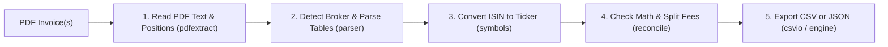
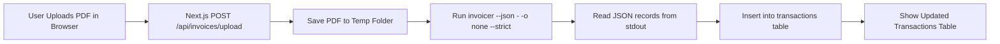

# Project Overview & Next.js Integration Guide

## 1. What This Project Is

**invoicer** is a fast Go program that reads brokerage PDF invoices (such as **Telda Securities** and **Thndr Securities Brokerage**) and turns them into clean, structured transaction records.

Instead of typing stock trades, prices, and fees by hand, `invoicer` automatically:
1. Reads the exact text and table layout inside every page of a PDF invoice (with no external tools like Python or Poppler needed).
2. Recognizes which broker issued the invoice (Telda, Thndr, or a generic trade confirmation).
3. Converts company ISIN codes (such as `EGS656M1C010`) into standard stock ticker symbols (such as `EGX:BONY`).
4. Checks all the math on the invoice (`Quantity × Price`, individual fees, `Total Fees`, and `Grand Total`) to catch any broken numbers.
5. Outputs either:
   - An **accounting CSV file** matching [samples/reference/CSV Format.csv](../samples/reference/CSV%20Format.csv), or
   - Clean **JSON data** (`--json - -o none`) that a web app like **Next.js** can save straight into a `transactions` database table.

---

## 2. How the Engine Works Step by Step



1. **Read PDF Text & Positions (`internal/pdfextract`)**: Opens PDFs (versions 1.0 to 1.7), decodes custom font maps (`/ToUnicode`), and keeps every cell's exact `(X, Y)` position on the page so columns stay separated and wrapped text stays together.
2. **Detect Broker & Parse Tables (`internal/parser`)**: Checks each page for Telda or Thndr markers (or falls back to a generic parser) and pulls out the trade date, stock code, `Buy`/`Sell` side, individual fills, and every fee line item.
3. **Convert ISIN to Ticker (`internal/symbols`)**: Keeps ticker codes like `EGAL` as `EGX:EGAL`, converts Egyptian ISINs like `EGS60101C010` to `EGX:SAUD` using a built-in dictionary, checks `config/symbols.json` for custom overrides, and can optionally look up new ISINs online via OpenFIGI (`--online-lookup`).
4. **Check Math & Split Fees (`internal/reconcile`)**: Verifies `Qty × Price = Value`, checks that all fee lines add up to `Total Fees`, and confirms `Total Value ± Total Fees = Grand Total`. If an order has multiple partial fills, it splits `Total Fees` cleanly to the exact piastre/cent with zero rounding error.
5. **Export CSV or JSON (`internal/csvio` & `internal/engine`)**: Formats rows cleanly (`Symbol,Side,Qty,Fill Price,Commission,Closing Time`), skips duplicates, and writes CSV or JSON.

---

## 3. Organized Project Structure

| Folder / File | Purpose |
| :--- | :--- |
| `bin/` | Compiled executable (`invoicer.exe` on Windows, or `invoicer-linux` for Linux servers) |
| `cmd/invoicer/` | Main CLI entry point (`main.go`) |
| `config/` | EGX ISIN and company-name symbol registry (`symbols.json`) loaded automatically |
| `docs/` | Plain-English project guides (`HOW_TO_RUN.md`, `PROJECT_AND_NEXTJS_INTEGRATION.md`) |
| `internal/` | Go packages for PDF reading, parsing, symbol lookup, math checks, CSV I/O, and engine runner |
| `output/` | Default folder where generated CSV and JSON exports are saved |
| `samples/reference/` | Target accounting CSV schema ([CSV Format.csv](../samples/reference/CSV%20Format.csv)) |
| `web/` | Standalone Next.js App Router client UI with a portable `src/features/invoicer/` module |

> **Using the included UI inside your target Next.js app:** Copy `web/src/features/invoicer/`, `web/src/lib/invoicer-server.ts`, and `web/src/app/api/invoicer/` into your Next.js App Router project, set `INVOICER_BIN_PATH` (and optionally `INVOICER_ROOT_DIR`), and render `<InvoicerWorkbench onTransactionsExtracted={(rows, report) => ...} />`.

---

## 4. How to Insert `invoicer` into a Next.js Web App

When a user uploads one or more PDF invoices in a Next.js app, you want the server to extract the transactions, check for errors, avoid duplicates, and store every row in your `transactions` database table.

There are **two simple ways** to connect `invoicer` to Next.js depending on where you host your site:

- **Option 1 (Recommended for VPS, Docker, Railway, Render, Fly.io, or local hosting):** Keep the compiled `invoicer` binary on your server and run it from a Next.js App Router API route.
- **Option 2 (Best for serverless hosting like Vercel):** Run `invoicer` as a small standalone Go HTTP service and call it with `fetch()` from your Next.js API route.

---

### Option 1: Run the `invoicer` Binary Inside a Next.js API Route



#### Step 1: Build the `invoicer` binary for your Next.js server

If your server runs **Linux** (most Docker, Railway, Render, and Ubuntu servers), build a single self-contained Linux binary from this project folder:

```powershell
$env:GOOS="linux"; $env:GOARCH="amd64"; go build -o bin/invoicer-linux ./cmd/invoicer
```

If your Next.js app runs locally on **Windows**, use [bin/invoicer.exe](../bin/invoicer.exe).

Copy that binary into your Next.js project (for example, inside `bin/invoicer-linux` or `bin/invoicer.exe`, and make sure it has execute permission on Linux: `chmod +x bin/invoicer-linux`).

#### Step 2: Understand the JSON Output

When you run `invoicer --json - -o none path/to/invoice.pdf`, it prints pure JSON to `stdout` (and skips writing any CSV file). Here is an example of what it returns:

```json
{
  "total_files": 1,
  "total_pages": 1,
  "brokers": { "thndr": 1 },
  "reconciled_passed": 1,
  "reconciled_warned": 0,
  "total_rows_extracted": 1,
  "skipped_duplicates": 0,
  "total_rows_output": 1,
  "records": [
    {
      "symbol": "EGX:SAUD",
      "side": "Sell",
      "qty": 130,
      "fill_price": 23.1,
      "commission": 8.25,
      "closing_time": "2026-11-17T00:00:00Z",
      "source_file": "E-INVOICE_2026-11-17.pdf",
      "page_number": 1,
      "broker": "thndr",
      "transaction_no": "TXN000000001"
    }
  ],
  "invoices": [
    {
      "broker": "thndr",
      "security_name": "Al Baraka Bank",
      "raw_symbol_code": "EGS60101C010",
      "resolved_symbol": "EGX:SAUD",
      "side": "Sell",
      "total_quantity": 130,
      "total_fees": 8.25,
      "grand_total": 2994.75
    }
  ]
}
```

The `records` array gives you every row already split, symbol-resolved, and formatted for your `transactions` table.

#### Step 3: Create Your `transactions` Database Table

Choose SQL (PostgreSQL / Supabase) or Prisma:

**Plain SQL (PostgreSQL / Supabase):**

```sql
CREATE TABLE transactions (
  id             BIGSERIAL PRIMARY KEY,
  user_id        TEXT NOT NULL,
  symbol         TEXT NOT NULL,           -- e.g. 'EGX:SAUD'
  side           TEXT NOT NULL,           -- 'Buy' or 'Sell'
  qty            NUMERIC(18, 4) NOT NULL,
  fill_price     NUMERIC(18, 4),          -- NULL allowed for $CASH / Dividend
  commission     NUMERIC(18, 2),
  closing_time   TIMESTAMPTZ NOT NULL,
  broker         TEXT,                    -- 'telda', 'thndr', 'generic'
  transaction_no TEXT,                    -- e.g. 'TXN000000001'
  source_file    TEXT,
  created_at     TIMESTAMPTZ NOT NULL DEFAULT NOW(),

  -- Prevents inserting the same fill twice if a user re-uploads an invoice
  CONSTRAINT uq_user_broker_tx UNIQUE (user_id, broker, transaction_no)
);
```

**Prisma Schema (`prisma/schema.prisma`):**

```prisma
model Transaction {
  id            Int      @id @default(autoincrement())
  userId        String
  symbol        String
  side          String
  qty           Decimal  @db.Decimal(18, 4)
  fillPrice     Decimal? @db.Decimal(18, 4)
  commission    Decimal? @db.Decimal(18, 2)
  closingTime   DateTime
  broker        String?
  transactionNo String?
  sourceFile    String?
  createdAt     DateTime @default(now())

  @@unique([userId, broker, transactionNo])
  @@map("transactions")
}
```

#### Step 4: Add the Next.js Upload API Route

Create `app/api/invoices/upload/route.ts` in your Next.js App Router project.

Important details:
- Set `export const runtime = "nodejs"` so Next.js allows file system and child process access.
- Use `execFile` (never `exec` with string concatenation) so filenames cannot cause shell injection.
- Always delete the temporary folder in a `finally` block.

```ts
// app/api/invoices/upload/route.ts
import { NextRequest, NextResponse } from "next/server";
import { execFile } from "node:child_process";
import { promisify } from "node:util";
import fs from "node:fs/promises";
import os from "node:os";
import path from "node:path";
// import { prisma } from "@/lib/prisma"; // Replace with your DB client

export const runtime = "nodejs";

const execFileAsync = promisify(execFile);

const BINARY_PATH =
  process.platform === "win32"
    ? path.join(process.cwd(), "bin", "invoicer.exe")
    : path.join(process.cwd(), "bin", "invoicer-linux");

const MAX_FILE_BYTES = 10 * 1024 * 1024; // 10 MB per PDF

interface ExtractedRecord {
  symbol: string;
  side: string;
  qty: number;
  fill_price?: number;
  commission?: number;
  closing_time: string;
  source_file?: string;
  broker?: string;
  transaction_no?: string;
}

interface InvoicerReport {
  total_files: number;
  total_pages: number;
  reconciled_passed: number;
  reconciled_warned: number;
  warnings?: string[];
  records: ExtractedRecord[];
}

export async function POST(req: NextRequest) {
  let tempDir = "";

  try {
    const formData = await req.formData();
    const files = formData.getAll("files") as File[];

    if (!files || files.length === 0) {
      return NextResponse.json(
        { error: "Please upload at least one PDF invoice." },
        { status: 400 }
      );
    }

    tempDir = await fs.mkdtemp(path.join(os.tmpdir(), "invoicer-"));
    const savedPaths: string[] = [];

    for (let i = 0; i < files.length; i++) {
      const file = files[i];
      if (!file.name.toLowerCase().endsWith(".pdf")) {
        return NextResponse.json(
          { error: `File "${file.name}" is not a PDF.` },
          { status: 400 }
        );
      }
      if (file.size === 0 || file.size > MAX_FILE_BYTES) {
        return NextResponse.json(
          { error: `File "${file.name}" must be between 1 byte and 10 MB.` },
          { status: 400 }
        );
      }

      const bytes = Buffer.from(await file.arrayBuffer());
      // Quick magic-byte check to ensure it is a real PDF
      if (!bytes.subarray(0, 5).equals(Buffer.from("%PDF-"))) {
        return NextResponse.json(
          { error: `File "${file.name}" is not a valid PDF document.` },
          { status: 400 }
        );
      }

      // Use a safe generated filename on disk
      const safePath = path.join(tempDir, `invoice-${i}.pdf`);
      await fs.writeFile(safePath, bytes);
      savedPaths.push(safePath);
    }

    const args = ["--json", "-", "-o", "none", "--strict", ...savedPaths];
    const { stdout } = await execFileAsync(BINARY_PATH, args, {
      timeout: 30_000,
      maxBuffer: 10 * 1024 * 1024,
    });

    const report: InvoicerReport = JSON.parse(stdout);

    // Example database insert (replace userId with your logged-in user's ID)
    // const userId = session.user.id;
    // await prisma.transaction.createMany({
    //   data: report.records.map((r) => ({
    //     userId,
    //     symbol: r.symbol,
    //     side: r.side,
    //     qty: r.qty,
    //     fillPrice: r.fill_price ?? null,
    //     commission: r.commission ?? null,
    //     closingTime: new Date(r.closing_time),
    //     broker: r.broker ?? null,
    //     transactionNo: r.transaction_no ?? null,
    //     sourceFile: r.source_file ?? null,
    //   })),
    //   skipDuplicates: true, // Uses @@unique([userId, broker, transactionNo])
    // });

    return NextResponse.json({
      insertedCount: report.records.length,
      pagesProcessed: report.total_pages,
      reconciledPassed: report.reconciled_passed,
      warnings: report.warnings ?? [],
      records: report.records,
    });
  } catch (err: unknown) {
    const message = err instanceof Error ? err.message : "Failed to process PDF";
    return NextResponse.json({ error: message }, { status: 422 });
  } finally {
    if (tempDir) {
      await fs.rm(tempDir, { recursive: true, force: true }).catch(() => {});
    }
  }
}
```

#### Step 5: Build the Upload UI & Transaction Table

Create a simple React Client Component (`components/InvoiceUpload.tsx`) that uploads selected PDFs and displays the extracted rows in a table:

```tsx
"use client";

import { useState } from "react";

interface TransactionRow {
  symbol: string;
  side: string;
  qty: number;
  fill_price?: number;
  commission?: number;
  closing_time: string;
  transaction_no?: string;
}

export default function InvoiceUpload() {
  const [rows, setRows] = useState<TransactionRow[]>([]);
  const [status, setStatus] = useState("");
  const [loading, setLoading] = useState(false);

  async function handleUpload(e: React.FormEvent<HTMLFormElement>) {
    e.preventDefault();
    const form = e.currentTarget;
    const input = form.elements.namedItem("files") as HTMLInputElement;
    if (!input.files || input.files.length === 0) return;

    const body = new FormData();
    for (const file of Array.from(input.files)) {
      body.append("files", file);
    }

    setLoading(true);
    setStatus("Extracting invoice transactions...");

    try {
      const res = await fetch("/api/invoices/upload", { method: "POST", body });
      const data = await res.json();
      if (!res.ok) {
        setStatus(`Error: ${data.error}`);
        return;
      }
      setRows(data.records);
      setStatus(`Saved ${data.insertedCount} transaction(s) from ${data.pagesProcessed} page(s).`);
    } catch {
      setStatus("Network error while uploading PDF.");
    } finally {
      setLoading(false);
    }
  }

  return (
    <div className="space-y-4">
      <form onSubmit={handleUpload} className="flex items-center gap-3">
        <input type="file" name="files" accept=".pdf,application/pdf" multiple required />
        <button type="submit" disabled={loading}>
          {loading ? "Processing..." : "Upload & Record"}
        </button>
      </form>

      {status && <p>{status}</p>}

      {rows.length > 0 && (
        <table>
          <thead>
            <tr>
              <th>Symbol</th>
              <th>Side</th>
              <th>Qty</th>
              <th>Fill Price</th>
              <th>Commission</th>
              <th>Closing Time</th>
            </tr>
          </thead>
          <tbody>
            {rows.map((r, i) => (
              <tr key={`${r.transaction_no ?? i}-${i}`}>
                <td>{r.symbol}</td>
                <td>{r.side}</td>
                <td>{r.qty}</td>
                <td>{r.fill_price ?? ""}</td>
                <td>{r.commission ?? ""}</td>
                <td>{r.closing_time}</td>
              </tr>
            ))}
          </tbody>
        </table>
      )}
    </div>
  );
}
```

#### Note for Docker Deployments
In your Next.js `Dockerfile`, copy the compiled Linux binary into your runtime image:

```dockerfile
COPY bin/invoicer-linux /app/bin/invoicer-linux
RUN chmod +x /app/bin/invoicer-linux
```

---

### Option 2: Run `invoicer` as a Small Go HTTP Microservice (Best for Vercel)

If your Next.js app is hosted on **Vercel** or another serverless platform, running a local binary inside serverless functions can run into size or execution limits. Instead, you can host a tiny Go HTTP server (for example on Railway, Fly.io, or Render) that imports `invoicer/internal/engine` directly:

```go
package main

import (
	"encoding/json"
	"fmt"
	"io"
	"net/http"
	"os"
	"path/filepath"

	"invoicer/internal/engine"
)

func main() {
	http.HandleFunc("/extract", func(w http.ResponseWriter, r *http.Request) {
		if r.Method != http.MethodPost {
			http.Error(w, "method not allowed", http.StatusMethodNotAllowed)
			return
		}
		if err := r.ParseMultipartForm(20 << 20); err != nil {
			http.Error(w, "invalid multipart upload", http.StatusBadRequest)
			return
		}

		tmpDir, err := os.MkdirTemp("", "invoicer-http-*")
		if err != nil {
			http.Error(w, "temp dir failed", http.StatusInternalServerError)
			return
		}
		defer os.RemoveAll(tmpDir)

		var pdfPaths []string
		for i, fh := range r.MultipartForm.File["files"] {
			src, err := fh.Open()
			if err != nil {
				http.Error(w, "failed reading uploaded file", http.StatusBadRequest)
				return
			}
			dstPath := filepath.Join(tmpDir, filepath.Base(fh.Filename))
			if dstPath == "" || filepath.Ext(dstPath) != ".pdf" {
				dstPath = filepath.Join(tmpDir, fmt.Sprintf("upload-%d.pdf", i))
			}
			dst, err := os.Create(dstPath)
			if err == nil {
				_, err = io.Copy(dst, src)
				_ = dst.Close()
			}
			_ = src.Close()
			if err != nil {
				http.Error(w, "failed saving upload", http.StatusInternalServerError)
				return
			}
			pdfPaths = append(pdfPaths, dstPath)
		}

		res, err := engine.Run(r.Context(), pdfPaths, engine.Config{
			Granularity: "fill",
			SortOrder:   "desc",
			Strict:      true,
		})
		if err != nil {
			http.Error(w, err.Error(), http.StatusUnprocessableEntity)
			return
		}

		w.Header().Set("Content-Type", "application/json")
		_ = json.NewEncoder(w).Encode(res.Report)
	})

	_ = http.ListenAndServe(":8080", nil)
}
```

Then in your Vercel Next.js route (`app/api/invoices/upload/route.ts`), forward the uploaded `FormData` directly with `fetch(process.env.INVOICER_API_URL + "/extract", { method: "POST", body: formData })` and save the returned `report.records` into your `transactions` table.

---

## 5. Simple Production & Security Checklist

- **Check `%PDF-` magic bytes & file size** before passing any uploaded file to `invoicer`.
- **Never build shell command strings** from user filenames; always use `execFile` with a safe temp filename like `invoice-0.pdf`.
- **Always delete temporary files** inside a `finally` block.
- **Prevent duplicate database entries** with a unique index on `(user_id, broker, transaction_no)` (and `skipDuplicates: true`).
- **Handle warnings cleanly**: if `warnings` is non-empty (for example, an unknown ISIN code on a newly listed stock), show the warning to the user or add the stock to `config/symbols.json` (or enable `--online-lookup`).
